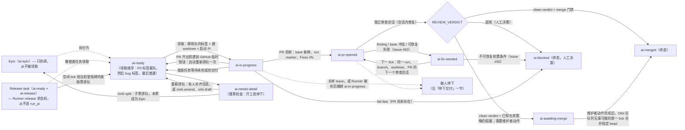

Orbi 会领取符合条件的 Issue，在 worktree 中实现，开 PR，独立审查，合并并记录结果。

一个 Orbi 任务是一个 runtime outcome，二选一形状：

- **修复** — 当 X，应该 Y，实际 Z。示例：
  [#1074](https://github.com/orbi-build/orbi/issues/1074) — 当
  `gh auth status` 退出码为 1 且当前账号有效时，Runner 应该解析出该
  账号；实际却因退出码让交付失败。
- **变更** — 当 X，用户应该能够 Y；今天不能，因为 Z。示例：
  [#1048](https://github.com/orbi-build/orbi/issues/1048) — 用户从
  发布镜像启动 runner 时，应该得到一个配好模型 provider 的
  runner；当时还没有任何代码读取 `ORBI_PI_*` 变量。

任务从一个 GitHub Issue 开始，以一个已合并的 PR 结束（或一个需要人工
的 `ai-blocked` 现场）。这一页覆盖完整的自动链路和项目的 GitHub 工作流
词汇。

## 完整链路

状态机（七个交付状态；review/fix 循环留在同一个 PR 上——只有它的 head
可以前进）：



```text
ai-ready                任务排队（orbi add，或人工加标签）；含义是
                        「还没开始」
  -> ai-in-progress     Runner 领取：移除队列标签、加上本标签，从冻结的
                        origin/<base> SHA 创建 worktree，启动 Pi session（prompt 携带
                        Issue body 加受信任评论时间线 {{ISSUE_COMMENTS}}，
                        Issue #745/#1806：只收对该仓有 write 权限的作者
                        的评论，按 issue_comments_limit 截断并显式标明
                        省略条数）
  -> ai-pr-opened       PR 验收通过（base 新鲜度、run marker、Fixes #N）；
                        该 tick 随即结束并释放槽位（Issue #788）——
                        交付等待它的评审 tick
  -> review             一个 tick 一步：可恢复扫描把 opened-PR 交付分类
                        为 RESUME_REVIEW；PR head 的 CI 仍 pending 时记
                        一行 journal（`delivery_ci_pending`）并跳过该候选
                        （Issue #1473）——tick 继续走 in-flight 与
                        fresh-claim 扫描，而不是就此结束（有界延迟，不丢
                        交付）。否则独立
                        Pi session——唯一的阻塞阶段，槽位只被占用一段
                        Pi 运行时长——审查精确的 base/head SHA，并在
                        会话内修复 findings（代码、目标仓库声明的
                        测试与覆盖率检查、只 push task branch），然后输出 REVIEW_VERDICT。其 prompt
                        除关联 Issue 的受信任评论时间线外，还携带**当前
                        PR** 上受信任的人类反馈：正式 review 状态以及
                        行内评论的文件/行号锚点。交付身份自己的 review
                        会被排除；PR 反馈只是输入，不是交付状态，也不会
                        往 PR 写 label。合并后的 Issue/PR 时间线共用同一个
                        issue_comments_limit 上限；读取 PR 反馈失败会记录日志
                        并退回仅使用 Issue 评论。
  -> ai-fix-needed      会话内未能修复 finding，PR 落后最新 base / 有
                        merge conflict，或已有 run/PR 的**可恢复失败**
                        （Issue #50：Pi 执行失败、验证失败、未推送本地
                        commit）：失败 comment 写入 Issue
                        和 PR，带完整现场（run_id、PR、branch、worktree、
                        session、phase、last activity、具体错误）；下一
                        个 tick 在同一 run_id、branch、worktree、PR 上
                        启动下一个审查会话
  -> merge              clean verdict（其 head 字段等于 PR head，
                        Issue #591）+ merge 门禁（head 包含最新 base、
                        CI 已有结论、PR mergeable、远端 head 未变；CI
                        pending 顺延到下一 tick，mergeable UNKNOWN
                        则按下文说明做有界重读）
  -> ai-merged          Orbi 自动合并模式：成功终态；合并同时清除
                        `ai-ready`，合并后的 Issue 只剩 `ai-merged`
                        （Issue #1526；不回溯已合并的 Issue）；
                        PR body 的 Fixes #N 原生关闭 Issue；若合并已落地但
                        GitHub 从未把 PR 标记为 merged，则由引擎自行关闭
                        （Issue #1801）；resume 时若 PR 已被 GitHub 报告为
                        merged 而 Issue 仍未关闭也由引擎关闭——用 workflow 的
                        GITHUB_TOKEN 合并不会触发关闭关键字，resume 因此记录
                        ai-merged 并关闭 Issue，而不是每个 tick 反复恢复它
                        （Issue #1895）
  -> ai-awaiting-merge  已知策略阻塞：Issue 评论写明维护者要做的一件事；
                        Orbi 只在队列无事可做的 tick 重试合并，
                        维护者完成后合并指定 head
```

已有 run/PR 的失败被分类（Issue #50）：**可恢复失败**（Pi 执行失败、
验证失败、未推送本地 commit、会话内未能修复的 finding）
留在自动修复循环——Issue 标记 `ai-fix-needed`，失败 comment 写入 Issue
和 PR（带完整现场），下一个 tick 在同一 run、branch、worktree、PR 上
继续（不重新创建 PR、不重复领取）。worktree 缺失根本不是失败：resume
会从远端交付分支重建它并继续推进（Issue #807——worktree 只是远端状态
的本地缓存，branch 和 PR 都在 GitHub 上）。只有 **AI 无法安全判断或修复的外部
前置条件**（无可恢复现场、base 分支变更、审查超轮、PR 未合并被关闭、
交付分支已从远端删除——没有任何东西可以用来重建 worktree）
才 fail fast：Issue 被标记 `ai-blocked` 并写明为什么不能自动恢复，自动
循环不再处理上述不可恢复现场——人工决定下一步。

已有 PR 的候选按 Issue 创建时间从早到晚扫描，一次最多检查 100 个；正在执行或 CI 待完成的候选会跳过，让其他交付继续。

延后合并时，已保存的通过评审可以省去一次新评审。复用要求保存的 PR head 和实际注入评审 prompt 的 Issue 正文 hash 都匹配。外部修改 head 或注入的正文时，需要重新评审；自定义 prompt 不含 `{{ISSUE_BODY}}` 时，正文改动不参与这项判断。Runner 自己吸收无冲突的 base 更新后，会更新记录里的 head、推送，并延后到后续 tick 检查这个 head 的 CI，合并门禁仍会核对当前 head 和 base。

## CI 用量：一次交付会触发什么，如何减少运行次数

交付本身不运行你的 CI：它推送到 GitHub，仓库里的 workflow 按这些推送
产生的事件运行。一次交付通常带来三类运行：

- **推送到 PR 分支。** PR 存在后，交付分支上的每次推送——实现推送、
每轮评审/修复推送以及每次吸收 base——都会更新 PR 并运行它的
`pull_request` workflow。
- **吸收 base 分支。** 交付进行期间 base 分支前进时，Runner 会把
`origin/<base>` 合入 task branch（打开 PR 前在 `src/orbi/runner.py`，
合并门禁处再在 `src/orbi/merge_exec.py`），推送新的 head，并在合并前
等待它的 CI。保留吸收是因为合并的内容必须针对当前代码验证过：否则
两个交付可能各自在旧的 base 上通过 CI，合在一起却弄坏 base。
- **合并本身。** 合并 PR 会在 base 分支上落地 commit，从而再次运行
仓库的 `push` workflow。

如果繁忙的队列和不断前进的 base 让运行次数超过额度，常用做法是：

- 用 `concurrency` 组并设置 `cancel-in-progress: true`，同一分支的新推送
会取消上一次运行，而不是把两次都跑完（见 GitHub 的
[并发指南](https://docs.github.com/en/actions/how-tos/write-workflows/choose-when-workflows-run/control-workflow-concurrency)）。
- 用 `paths-ignore` 让只改文档的推送跳过昂贵的 pull request workflow。
- 不要往 `pull_request` workflow 的 `types` 里加 `labeled`，这样 label
变化不会启动运行。
- 只在推送到 base 分支时运行慢的端到端套件：运行更少，代价是合并之后
才发现失败。

额度与价格取决于 GitHub 账号和套餐。本页不列价格，也不列额度数字——
见 GitHub 的
[Actions 计费页面](https://docs.github.com/en/billing/concepts/product-billing/github-actions)。

## 运行中的交付修正

无需取消正在进行的交付，也可以修正方向。当 Issue 处于
`ai-in-progress` 时，可以评论新的决定，或直接编辑 Issue body。Runner 会在
下一次 steering 轮询时检查可信修正（间隔由 `steering_poll_seconds` 控制，默认
60 秒），并带着修正重启当前 session。
重启次数由 `steering_max_rounds` 限制（默认 3 次）；达到上限后，后续修正
不会再重启这次交付，journal 会记录 `steering_limit_reached`。让当前交付完成，
再把修订后的范围放入后续交付。

Runner 对评论作者和 Issue 正文最后一位编辑者应用同一信任规则。GitHub 报告
该账号在仓库中拥有 `admin` 或 `write` 权限（`collaborators/{login}/permission`），
或者该账号就是 Runner 已认证的账号时，修正才会生效。评论的
`authorAssociation` 反映成员身份以及读取令牌可见的信息。Runner 会忽略
不受信任或身份不明的编辑者所做的正文修改，并在 journal 中记录
`steering_body_untrusted`。初始受信任评论时间线受
`issue_comments_limit` 限制（默认 200 条）：更早的评论会被丢弃，注入的上下文
会明确说明省略了多少条。

停止问题也可以在**会话进行中**回答
（见[停止问题](/zh/public-contracts#停止问题)）。steering 轮询读取回答
记录，用与 `/orbi amend` 相同的追加逻辑把该回答隐含的验收标准写入 Issue
正文，再由上面的重启把修改后的工单带给新 session，且只重启一次。只有引擎
自己写入的正文会被跳过——与 Runner 共用账号的维护者仍按“人”处理，手改正文
仍然会生效。关闭类回答（含 `cancel`）只在工单处于 `ai-blocked` 时执行；
会话进行中只留下一条说明原因的回执，不改动任何状态。


死循环守卫与评论去重（Issue #825）：接续现有 attempt 沿用 run id；
重新领取或接管同一交付线时，可以用新 attempt 继续原 branch 和 PR。
PR body 只在创建时写入一次，所以 resume
校验接受本交付线曾用过的**任一** run marker——marker 集合读自 Issue 的
受信任评论（与恢复现场同一信任过滤，公开评论里复制的 marker 不计入；
branch、base、head、精确 URL 校验全部保留，#45/#89 的防串 PR 语义不变）。
同一 `(run_id, 失败指纹)` 的失败评论全程只发一次（隐藏的
`<!-- orbi:fail=... -->` 标记为键），后续相同失败原位递增该评论的隐藏
`:次数` 后缀（journal 记录重复）；同一 `(run_id, 失败指纹)` 连续失败
达到 3 次（现场块——新开的 PR、完成的评审轮——代表交付线前进，会重置
连击）即判定死循环而非抖动，升级为 `ai-blocked` 并在评论里写明连续
次数与「前置条件未变化」。

可恢复的 Pi/model 失败受同一上限约束（Issue #2292）：它的恢复评论也带
`<!-- orbi:fail=... -->` 标记，因此单次发生仍保持 `ai-in-progress` 并由
下一个 tick 接续同一运行；同一指纹连续 3 轮则停止循环、进入 `ai-blocked`。
该停止只有一条阻塞评论，写明原因和需要人做的决定（回答 agent 的问题或
修改工单，然后重新打标签）；停止后失败工作树按 `keep_failed_worktrees`
（默认开启）保留，agent 未提交的改动仍可检查——runner 从不提交它们。

链路规则：

- 开发交付在 review/fix 期间保留同一 branch 和 PR。每个 attempt 有一个
  run id 和 worktree，接续该 attempt 时沿用；重新领取或接管可在原
  branch/PR 上开启新 attempt。沿 Issue 的受信任评论找各次 attempt 的标记。
- 只有两个 opened-PR 状态会被自动拾取：`ai-pr-opened`（等待 review）
  和 `ai-fix-needed`（等待下一个审查会话）。`ai-ready` 作为新工作被
  领取；`ai-blocked` 通常等待人处理；v0.7.15 的
  [`base_ci_red` 恢复](#交付因基础分支已红而暂停base_ci_red)与 v0.7.18 起的
  [`checks_permission_missing` 恢复](#交付因-app-权限未批准而暂停checks_permission_missing)
  是明确的例外。仍带着 `ai-in-progress` 的交付
  （旧版本 Runner 在 review 中被杀时留下的）仍会被拾取——正向的 opened-PR
  限定已保证 implement 阶段的 Issue 不会匹配该扫描。
- `ai-awaiting-merge` 是等维护者的等待态，因此永不与 Runner 能推进的工作
  抢 tick（Issue #1745）：只有在 opened-PR 评审、in-flight 接续和 ready
  领取三个扫描本 tick 都无结果时，才用同一条 merge-only 路径重试一次。
  一个等批准的 PR 因此不会再让评审队列和新票领取停摆。代价是：维护者
  动作之后，合并发生在队列首次无事可做的那一 tick，而不是紧接着的下一
  tick。三个扫描覆盖这个 Runner 管的所有仓库，所以同一个 Runner 管的
  其他仓库有活时，这次合并会一起往后推。
- review/fix 循环有界（5 轮）。已完成轮数存在受信任现场里
  （`review_round` 字段，Issue #788）：每条轮次评论携带更新后的现场
  块，下一 tick 从中读出推进后的计数（人工在 block 之后把 Issue 改回
  ai-fix-needed 的恢复仍会重置预算，Issue #483）。超轮仍有 findings 时
  Issue 标记 `ai-blocked`（超轮是人工决策）；可恢复失败（Issue #50）
  保持 `ai-fix-needed`。无论哪种，PR、branch 和 worktree 原样保留。
  评审会话自己也守卫预算（Issue #878）：开工前其 prompt 会读本交付
  （同一 `run_id`）的轮次评论，当同一失败原因已连续出现在两轮及以上
  时，直接发点名重复的 findings verdict，不再重复同一修复路径——
  同一堵墙最多撞两轮。
- 普通开发交付把 CI 等待留到后续 tick（Issue #788）：记录状态、返回、
  释放 slot，下一个 tick 重读（`delivery_ci_pending`、
  `merge_gate_ci_pending`、`merge_gate_mergeable_unknown`）。等待期间该
  Issue 的进度评论用一行说明：在等哪个 commit 的检查，以及检查通过后
  Orbi 会自动合并——不承诺时间，也不承诺下一个 tick（Issue #2304）。
  评审扫描跳过 CI 待完成的候选，让其他工作继续。一个有界例外（Issue
  #2305）：已通过评审、只等最新 head 的 checks 的交付（#1626 评审记录的
  head 等于 PR head、至少一个 check 在跑、没有失败、距记录时间不超过 15
  分钟），在机器上没有空闲 slot 时只暂缓 FRESH claim——只跳过这一步，slot
  留给这次 merge，并记一行 `review_waiting_delivery`。其他都不会被暂缓：超过
  15 分钟就按上面的方式照常 claim，空 check 列表、有失败的 check、仍有其他
  空闲 slot、in-flight restart 扫描以及 `ai-awaiting-merge` 的复查都照常进行。
  单 slot 时最多空转约 20 分钟（上限加上 5 分钟的 timer）。
  发版另用进程内的 CI 轮询，等待期间持有一个 slot，上限由 `release_ci_wait_seconds`
  决定，每次 CI 门禁默认 1800 秒，不是整个发布总时限。
  开发交付还有一个短等待：GitHub 异步计算的 mergeability（Issue #1736）：merge
  gate 首次读到 `UNKNOWN` 且该 head 的 CI 已得出结论时，会在 2 s、4 s、
  8 s 后重读整个 PR 状态（`MERGEABLE_UNKNOWN_RETRY_DELAYS`），GitHub 一
  给出结果就在同一 tick 继续——最多约 15 s 槽位时间。rollup 仍 pending 或
  有失败时绝不重读；所有重读仍为 `UNKNOWN` 的 PR 依旧按上面的方式顺延。
  PR 视图始终没有跟上交付自己 push 的情况是另一种等待（Issue #2440）：merge
  gate 读到 `UNKNOWN` 且 PR head 不是 `origin` 上该分支的最新提交时，Runner
  会请 GitHub 自己更新该 pull request 分支（用分支最新提交作为
  `expected_head_sha` 调用 `PUT /pulls/<n>/update-branch`，并记
  `pr_head_lagging`、`pr_head_refresh_requested`），GitHub 重新读取分支后交付
  在刷新后的 head 上继续。尝试次数有界，最多三个 tick
  （`PR_HEAD_REFRESH_TICKS`）；超过上限即 `ai-blocked`，评论写明原因（GitHub
  没有刷新该 PR）和修复办法（往分支推一个新提交，或用 PR 的 “Update
  branch” 按钮），不再无限轮询。
- base 前进由 task branch 上对最新 `origin/<base>` 的普通 `git merge`
  吸收（冲突手工解决），然后重跑完整测试。不 force push、不自动解决
  冲突、不 push 保护分支。
- 检查为红、且只是缺少 base（GitHub 报告 PR 可合并，即没有冲突）的 head，
  会在评审 session 启动前由 Runner 直接吸收并推送（Issue #2423）：不会在
  这个过期 head 上启动 session，不计数评审轮，不发失败评论，下一 tick 评审
  新的 head。base 已经修好的红检查因此不再让交付结束——用
  `ai-fix-needed` 重新排队就会带上这个修复。
- 已经包含 base、且某个失败的检查在该 base 提交上也失败的 head，会在评审
  session 启动前就被暂停为
  [`base_ci_red`](#交付因基础分支已红而暂停base_ci_red)
  （Issue #2442）：使用与合并门相同的判定，比较的是 head 当时真正包含的
  base 提交（而不只是开轮时冻结的 SHA），因此只会开一个修复 Issue、交付被
  暂停，并在 base 转绿后自行恢复——不会对「在 base 修好前无法合并」的 PR
  白跑一轮评审。base 上对应的检查尚未得出结论时不算绿：该 tick 不写记录、
  不启动 session，下一 tick 再看。其余红 head——base 在所有失败检查上都绿，
  或 head 并不包含 base（冲突）——仍走上面的路径：评审在红 head 上运行，
  冲突的 head 在 session 内吸收。
- 吸收契约（Issue #877，Runner 机器校验）：一轮评审开始时 head 已落后
  `origin/<base>` 或 PR 有冲突时，该轮结束必须满足二者之一——分支包含
  `origin/<base>`（`git merge-base --is-ancestor` 为真），或 verdict 为
  `findings` 且写明「本轮尝试吸收但放弃」及具体原因。head 仍不含 base
  的 `pass` 会在轮次评论里被 Runner 点名为违反吸收契约（
  `review_absorb_abandoned`）；既有 5 轮有界语义不变。
- Git transport（Issue #114、#580）：git 数据操作走配置的传输方式
  （`git_transport`：默认 `ssh`——git over SSH——，或 `https` 走
  `gh` credential helper），GitHub API 操作留在
  `gh` token 上——完整的双通道边界与启动前检查见[运维](/zh/operations)；
  凭据见[安全](/zh/security)。

### Reviewing with a different model（用不同的模型评审）

独立评审不必运行在写代码的同一个模型上：`review_pi_provider`、
`review_pi_model`、`review_pi_thinking` 为评审会话单独选择
provider/模型/思考级别，评审者因此不会继承实现者的盲区。每个键独立
回落到实现侧的对应值（`review_pi_provider` → `pi_provider`、
`review_pi_model` → `pi_model`、`review_pi_thinking` →
`pi_thinking`），只覆盖其中一个也有效。两个选择都必须存在于配置的
`pi_providers` 目录中，并在启动时分别校验——评审选择非法会以
`review provider selection invalid` fail fast。本文不推荐也未实测
任何具体配对；能力与回落机制才是契约。

```toml
# 实现运行在一个模型上，独立评审运行在另一个模型上。
pi_provider = "z-ai"
pi_model = "glm-5.3-flash"

review_pi_provider = "groq"
review_pi_model = "groq/compound"
```

## 合并账本：`external_commits` 与 `commits`

Runner 合并交付 PR 时，`Orbi merged PR:` Issue 评论只展示用户真正
要行动的三件事——PR 链接、review 结果与目标分支——并把
merged-as-is 事实（Issue #833）收进一个折叠的 `Run details` 块：

```
Orbi merged PR: <url>
- review: pass, no findings (2 review rounds)
- merged into: main

<details><summary>Run details</summary>

- merge_commit=…
- review_rounds=N
- commits=M
- external_commits=K
- run_id=…
- pr_url=<url>

</details>
```

`Run details` 行保持 `key=value` 形式（等号，不是冒号），因为它们是
机器读的锚点：orbi-cloud 的 `mergeCommentFields` 读取器与本仓库的
comment-reader 契约精确匹配 `external_commits=K`、`review_rounds=N`、
`run_id=…` 与 `pr_url=<url>`。`pr_url` 是明确的 PR URL，消费者无需读取
可被翻译的 `Orbi merged PR:` 标题；该回执在 run marker 之后紧接隐藏的
`<!-- orbi:comment=merged -->` 类型，两条规则都定义在
[Public contracts](/zh/public-contracts)。`Orbi: merged` milestone 行面向
人读，同样带上这些事实；它的行属于显示文本，标签跟随消息语言——消费者
不从 milestone 读取事实，机器读取面只有回执的 `Run details` 折叠块。

- `commits` —— 合并时 PR 分支相对 base 的全部 commit 数（比例的分母）。
- `external_commits` —— 不在引擎自己推送历史里的 commit 数（开 PR 时的
  head 加上 Runner 自己推的每一轮 review/fix head；绝不检查 git 作者
  身份）。`0` = merged as-is：合并前没有人改过交付分支的一行。计数在
  合并后通过 merge commit 的父链读取（`M^1` 为 base 端、`M^2` 为 PR
  head），减去引擎记录的推送线：最后一个引擎推送 head；外部接管
  （Issue #608）时再排除接管的贡献者 head（推送线的起点），贡献者的
  commit 保持为外部。
- `external_commits=unknown` —— 推送历史无法证实（重建的 worktree 丢了
  run-state 记录；某轮 fix 推送在记录之前回合已结束且历史不完整；或
  记录的 head/base 不是合并 head 的祖先）。squash 或 rebase 合并
  （Issue #1480）没有 `M^2`，两项指标同样为 `unknown`。数不出来的历史
  绝不写成 `0`。

引擎推送 head 在三个点记入 task worktree 的 run state（`pushed_head`，
Issue #219 文件）——交付推送、verdict 覆盖的 review/fix 推送、以及
回合开始时对上一 session 已推送但回合在 re-freeze 记录之前结束的
head 的采纳——同一 worktree 的接续都能恢复这份历史；全新的 worktree
从无记录开始，退化为 `unknown`。外部接管在 claim 时一次性记录接管的
起点 head（`pushed_base`），且其回合开始的采纳永不运行：worktree 本来
就始于贡献者的 head。记录本身是 bypass：state 文件缺失或损坏只记
`pushed_head_unrecorded` 日志，交付继续。

## 交付标签

GitHub 标签是外部状态机。它们不是 commit 创建的——每个仓库要初始化
（见[快速开始](/zh/getting-started)）：

| 标签 | 含义 |
|---|---|
| `ai-ready` | 队列：已派发给 Orbi 且**尚未开始**。领取时在同一次写入里移除它并加上 `ai-in-progress`，此后每个非终态阶段事件也会移除它（Issue #2309），所以 `is:open label:ai-ready` 只列出还没开始的工作 |
| `ai-in-progress` | 已领取、正在执行。接续 opened-PR 交付时不再加回该标签：opened-PR 标签保留，从 `ai-fix-needed` 接续的轮次最后只剩 `ai-pr-opened`（Issue #2357）；被杀后的残留由下一 tick 接回（前提是本部署仍持有该任务 worktree 与 run state 文件；不是本部署启动的 Issue 属于另一个部署，会被跳过，Issue #2256）。实现阶段的运行只靠这个标签被找到（Issue #2309） |
| `ai-pr-opened` | PR 已创建并验收；等待独立审查 |
| `ai-fix-needed` | PR head 尚不可合并，或已有 run/PR 的可恢复失败（Issue #50）；下一 tick 在同一 run、branch、worktree、PR 上继续 |
| `ai-merged` | 成功终态；Runner 已合并 PR 并确认 merge commit 落在保护分支。合并同时清除 `ai-ready` 残留，因此合并后的 Issue 只剩 `ai-merged`（Issue #1526；不回溯已合并的 Issue）。每次交付标签变更都是基于 Issue 真实标签的一次整体替换：失败后 Issue 要么保持变更前的标签，要么正是变更想要的标签，而 `bug`、`p0` 这类非交付标签始终保留（Issue #2426） |
| `ai-awaiting-merge` | 评审和检查已通过，但已知仓库策略仍阻塞合并；评论写明维护者动作。只在队列无事可做的 tick 重试（Issue #1745），随后由 Orbi 合并指定 PR head |
| `ai-blocked` | 交付已停下且无法自动恢复：AI 无法安全判断或修复的外部前置条件（Issue #50），或动作为 `fix_ticket`、`decide` 的失败（如 `no_commit_delivered`、`release_failed`、`review_budget_exhausted`，见下文「失败记录」一节的原因表）。blocked comment 写明原因和动作；人工必须决定下一步 |
| `ai-human-review` | 人工验收门禁（Issue #763）：人已确认该交付的验收清单。只有人能打或摘——Runner 永不增删 |
| `ai-needs-detail` | 薄 ticket 闸门（Issue #1088）：ticket 说得太少无法交付，Orbi 在开工前停住。Runner 把 `ai-ready` 换成它，并只发一条列出缺失项的评论；人补齐后重新加 `ai-ready` |

「排队」意味着尚未开始（Issue #2309）。`is:open label:ai-ready`——或该仓库的
`dispatch_label`——就是队列。默认的 `ai-ready` 是数据而非代码：它是引擎
`labels.toml` 里的 `queue` 角色，优先级为仓库 `.github/orbi.toml` 的
`dispatch_label` > `labels.toml`（Issue #2347）；宿主 `orbi.toml` 不读它。领取在同一次写入里移除该标签并加上
`ai-in-progress`，此后每个非终态阶段事件也会移除它，所以旧规则下领取的票
在下一次阶段事件时自然收敛。只有被放回队列的票才会重新加上它：requeue、
人在 `ai-needs-detail` 之后手动重加、amend/draft/split 的重派发路径、空闲
时的 release 武装，以及因有未完成交付而等待的 release。`dispatch_label` 可
以是任何普通标签，但绝不能是生命周期、类型、优先级或控制标签——仓库配置
加载会拒绝并点名冲突的标签。

仓库策略可能在 Orbi 的评审和检查都通过后仍阻塞合并。Orbi 交付 PR 后停止
在 `ai-awaiting-merge`；Issue 评论写出精确 head 和维护者要做的一件事（适用时
包含设置 URL）。这种交付是等待而不是可推进的工作，所以只有在 opened-PR、
in-flight 和 ready 三个扫描本 tick 都无结果后才会被重试：等待中的 PR 不再
抢走评审、接续或新领取的 tick。维护者完成策略变更或给出所需批准后，队列
首次无事可做的 tick 恢复，仍由 Orbi 自己合并 PR——这条规则的代价就是它
不是紧接着的下一 tick；而且看的是这个 Runner 的整条队列，同一个 Runner 管的
其他仓库有活时，合并也会一起往后推。若 preflight 没有已知的 FAILED 动作，或是其他合并
失败，仍进入 `ai-blocked`。

### 停下交付

- **还没被领取**：摘掉队列标签。
- **正在跑**：关掉 Issue。正在跑的会话不会被打断；它跑完后，Orbi 把工作推到任务
  分支、不开 PR，并在 Issue 上留言说明交付已停止。PR 已经开出的，之后的 tick 不再
  接这个交付，Orbi 不会再评审或合并它，并在 PR 上留言：要保留这份工作就合并它，否则
  关掉。已经在跑的评审轮次不会被打断，仍可能合并；要拦住这次合并，就打上
  `ai-blocked`，合并门禁在合并前会读它。摘标签停不下正在跑的会话。
- **被中断**（Runner 被杀，下一个 tick 会接回）：实现阶段的运行靠 `ai-in-progress`
  加上本部署自己的任务 worktree 与 run state 文件被找到（Issue #2309）。摘掉
  `ai-in-progress` 或关掉 Issue，就不会被接回。
- **升级到本规则之前领取的票**：可能还带着队列标签。两个标签都摘掉，或关掉 Issue：
  只摘 `ai-in-progress` 会留下队列标签，ready 扫描会把它当新工作再领一次。
- **跨过这次变更升级**：按旧规则只摘 `ai-ready` 停掉的交付还带着
  `ai-in-progress`。升级后的引擎只凭这个标签找被中断的运行，会把它接回，所以升级前
  把 `ai-in-progress` 也摘掉（或关掉 Issue）。

## 人工验收门禁（ai-human-review）

产品主线是无人值守：默认流水线人在环外运行，且本门禁默认关闭——开关
关闭时交付、评审、merge、release 的行为与 Issue #763 之前逐字节一致。

host 配置打开门禁（`orbi.toml` 里 `human_review_gate = true`——这是部署
方的信任决策，不是仓库可写策略）。打开后每个交付在 PR 打开时向 Issue
发一条验收清单评论，分两栏：

- **栏一 · 本次 run 已验证的**（证据，不是待办）：PR head 的 CI 检查
  状态（Issue #1613：引擎不再解析本地测试日志）、覆盖层（仓库测试套件）、
  改动文件数。
- **栏二 · 机器验不了的最小集合**，按每个交付的改动路径与可用证据生成
  （不是硬编码的"人类专属"模板）：业务意图（测试只证明实现与测试一致，
  不证明测试与意图一致）、UI 视觉与文案、外部环境验证，以及 head 的检查
  未通过或 diff 不可读时的证据缺失条目。

栏二非空时它就是门禁：评审轮次在任何 Pi session 之前短路——清除
`ai-in-progress` 与队列标签，**什么都不加**（等待中的票不在队列里，
Issue #2309），opened-PR 标签保留作 resume 锚，槽位释放，此后每个 tick
结束时标签不变、不写任何标签，也不启动评审 session。等待**不消耗**评审轮次预算，也**不碰**
`ai-fix-needed`。
人确认清单后打 `ai-human-review`，下一 tick 照常评审与合并（verdict 绑定
与 `--match-head-commit` 零改动）。

栏二为空是目标状态：清单明确写「无需人工介入」，交付不要求该标签直接
通过。模型能力提升时，栏二条目迁进栏一——清单评论带机器可解析的
`<!-- orbi:human-review {...} -->` 块（schema 1），迁移可以做工具化，
工件形态不变。清单不声称任何正确性保证：栏一是已验证内容的证据，栏二是
人仍需确认的最小集合。

## 薄 ticket 闸门

对一个含糊的 ticket 自信交付，比不交付更糟：烧掉一次 run、开出一个没人
能接受的 PR，还把你真正要问的问题埋掉。闸门默认关闭，仓库用
`.github/orbi.toml` 里的 `clarify_thin_tickets = true` 打开；未启用的仓库
行为与之前完全一致。

闸门打开时，一次 fresh claim 会先问一次 Pi session（无 worktree、无分支、
不交付）判定 ticket 的三项检查：**可观察结果**（用户会看到或做得了
什么不同的）、**验收条件**（怎么区分完成与未完成）、**单一结果**（一个
fix 或一个 change，而不是几件互不相关的事）。判定与所有其他 Issue session
读同一份内容：正文**以及**随票附带的图片（Attachment 小节，以及正文或可信评论里
的任何原生 GitHub 图片；见[公开契约](/zh/public-contracts#附件)），因此结果与
验收条件写在截图里的票也能带着截图一起判定。判定通过则一切不变，交付照常开始。

判定 session 不加载任何内建工具：它以
`--no-builtin-tools --no-extensions --extension <随引擎发布的 clarify_verdict>`
运行，模型只有一条回答途径——调用一次这个受 schema 校验的工具，由工具把
判定写进引擎读取的文件。既没有自由文本答案，也不解析 stdout。任何不可用的
答案（没有文件、文件内容不合 schema、未知的检查 id）都与模型不可用一样是
bypass。

v0.7.15 起按需求含义判断，不要求固定模板标题。明确的运行失败及其清楚的纠正方向可以表达结果；同一失败的多个症状仍可算一个结果。过去某次运行的日志本身不等于验收条件。

判定不通过、且唯一缺失项是验收条件、同时答案带有可用的 `criteria` 提案时，
闸门直接用票面已有的文本把它补齐：把提案中的验收条件按仓库的 `message_language`
追加到正文的验收标题下（与 `/orbi amend` 写入的段落完全相同，含隐藏标记
`orbi:acceptance:v1`），并发一条评论列出新增的内容、说明编辑这张工单即可修改
它们。此时不加 `ai-needs-detail`，本次领取继续交付——人已经用认领标签授权了
这项工作。写入失败则退回下面的中止路径，可由 `/orbi amend` 补完；正文已带有
该追加段落的工单不会被追加第二次。

判定不通过、但答案附带**可用的拆分建议**时，也不再等人（Issue #2207）：建议完全来自
票面文字，作者加上认领标签就已授权这件事，因此闸门在本次领取中直接应用它——
与 `/orbi split` 完全一致。子票被创建、挂成本票的原生子票、带上各自的
`blockedBy` 依赖并带上认领标签排队；本票成为 Epic（`ai-epic`，移除认领标签），
只发一条评论列出这些子票。父票本身不交付，本 tick 结束后没有 worktree、分支、
Pi session 或 PR。应用中途中断是安全的：每一步都先读 GitHub 上的真实状态，因此
中断后重新领取会沿用已创建的子票，不会重复创建。应用过程中 GitHub 写入失败则回退
到下面的中止流程——评论里仍然带着这份建议、票上带着 `ai-needs-detail`，由
`/orbi split` 接着完成，半拆的父票绝不会被交付。

其他判定不通过的情形则在任何工作存在之前中止本次尝试：只发一条评论列出全部缺失项
与修复动作，把该仓库的认领标签（默认 `ai-ready`，可经 `dispatch_label` 改名）
换成 `ai-needs-detail`，本 tick 结束——无
worktree、无分支、无 Pi session、无 PR，槽位留给下一个 Issue，该票与
`ai-blocked` 一样等人。重新编辑 Issue 并加上该认领标签才获得下一次机会，
届时判定从头再跑一遍——或者在停票评论带有建议时，由有 write 权限的人回复
`/orbi amend`（把建议的验收条件追加到正文并重新排队）或 `/orbi split`
（按建议建子票，本票转为 Epic）。正文未改动时重新加认领标签不会再次判定、
发评论或发通知：本 runner 自己写的中止评论记录了当时判定的正文，下一次领取
会重新套用中止、移除
认领标签，队列中的其他票不受影响。不是本 runner 写入、却带有该标记的评论会被忽略。

所有错误路径都是**旁路**——闸门绝不会弄丢一次交付。模型报错或超时、答案不可
用、评论或标签写入失败，都只记 `clarify_check_skipped` journal 行，交付照常继续。
唯一的例外是闸门读不出的附带图片：它是既有的附件停止，而不是旁路、也不是判定——
Issue 停在 `ai-blocked`，只有一条评论指出图片与修复方式，与交付 session 完全一致
（原因码 `attachment_unavailable`，Issue #2364），因此读不出的图片绝不会被当作
“缺少细节”，也绝不会被跳过。
判定与中止分别对应 [Operations](/zh/operations#事件参考) 里的
`clarify_check_skipped` 和 `clarify_needs_detail` 行。

## 票派发：content、dev、ops

`ai-ready` 是所有任务类型的执行开关；第二个标签选择类型
（Issue #537）。共三类——派发时每个 Issue 选定其一：

| 票类型 | 标签 | Runner 做什么 |
|---|---|---|
| dev（默认） | `ai-ready` | 完整交付链：worktree、开发剧本、一个 PR、独立审查、合并 |
| ops | `ai-ready` + `ai-ops-only` | 同一个完整执行会话（worktree、shell、网络——实现里不存在任何命令白名单），但用 ops 剧本替代开发剧本。交付物 = 回到票上的证据；会话若附带代码 commit，则照常走 PR 流程。只有部署之后才算数的改动也用这一类票检查——见[验证部署后的运行时结果](#验证部署后的运行时结果) |
| content | `ai-ready` + `ai-content-only` | 内容代理：文本进、文本出，以 Issue 评论交付——无执行、无 git；交付后关闭 Issue |

ops 语义（Issue #537）：

- **信任边界是（凭据，票面）——不是命令白名单。** 会话原样获得 runner
  的全部环境（gh 凭据、`CLOUDFLARE_API_TOKEN`、AWS keys 等，外加
  deploy home 的 `.orbi/env` 文件）；凭据给多宽是用户的决定，runner
  不做二次裁剪。
- **票面即授权。** 会话只执行票面写明的 ops 动作（合并哪个 PR、部署
  哪个环境）；票面之外的动作回帖说明并停。人工审批门（environment
  approval、Release 批准）不由会话代行——这是提示词约定，不是执法代码。
- **交付 = 证据**（Issue #526 的事实文化）：每一步把真实命令与真实
  输出 / API 返回原文贴到票上；未执行的步骤如实标注未执行。纯 ops 运行
  （无 commit）以 Runner 关闭 Issue 并摘除 `ai-in-progress` 收尾——
  无 PR。附带代码 commit 则照常走 PR 路径（审查 + 合并）。

调研型票（Issue #739）：票面要求只调研/设计——「先调研，不要直接写
实现」——的票，派发时就是 ops 票：打 `ai-ready` + `ai-ops-only`。
dev 票带不动这个指令：dev 的交付判据是 task branch 上有新提交，
照办不提交的 agent 会以 `the agent delivered no commit` 失败，票被
烧成 `ai-blocked`。ops 剧本的证据纪律（真实命令、原文输出、未验证项
如实标注）就是调研交付物本身；无 commit 的 ops 运行正常收尾（关票、
摘除 `ai-in-progress`），调研后继续落地的代码仍走正常 PR 流程。

Issue #537 之前，`ai-ops-only` 标签派发的是内容代理（#530 只改了名，
模式未变——名字承诺 ops，模式仍是纯内容）；现在 content 路径派发到
`ai-content-only`，`ai-ops-only` 是完整执行的 ops 路径。

## Run marker 与 run_id

每个任务 attempt 生成一个 `run_id`（8 位 hex，例如 `e07383c2`），该
attempt 的执行与接续都复用这个值；重新领取或接管时开启新 attempt，
可以用新 id 继续原 Issue 和 PR。同一个 id 出现在：

- 该 attempt 的每条 journal 行（前缀 `[e07383c2]`）；
- Issue/PR 评论：可见字段 `run_id=e07383c2` + 隐藏机器可读 marker
  `<!-- orbi:run=e07383c2 -->`；
- 评论类型：隐藏的 `<!-- orbi:comment=started -->`、`<!-- orbi:comment=failure -->`、
  `<!-- orbi:comment=review-round -->` 与 `<!-- orbi:comment=merged -->` 标记独立于可见（可被翻译）的标题，
  识别 started、完整 failure、已完成 review-round 与 merged 评论；类型、其前缀
  规则与合并回执的固定行定义见 [Public contracts](/zh/public-contracts)；
- 里程碑与场景评论还携带隐藏的 runner marker `<!-- runner=1a2b3c4d -->`：
  写出评论的部署指纹——执行 checkout 的 HEAD；非 editable 安装为包版本；
  探测失败为 `unknown`（live progress 评论与 PR 评论不带它）；
- `Orbi opened PR` 场景评论携带隐藏的带版本 run 现场
  `<!-- orbi:scene:v1 {json} -->`（`src/orbi/scene.py`）：这是 resume
  扫描解析的机器可读恢复记录——现场损坏与现场缺失是两个不同的失败
  分支（Issue #786）；
- worktree 名（`.worktrees/orbi-<owner>-<repo>-issue-<n>-e07383c2`），以及 Pi
  session 目录和 run 产物；
- PR body——稳定 marker `<!-- orbi:run=e07383c2 -->` 是 PR 契约
  的一部分；Runner 拒绝没有它的 PR。

feature branch 按 Issue 稳定命名（`orbi/<owner>-<repo>-issue-<N>`），
不含 run id。先从 Issue 的受信任评论找齐各次 attempt 的 id，再分别查时间线：

```bash
journalctl --user -u orbi@1.service -u orbi@2.service | grep e07383c2
gh search issues "e07383c2" --repo OWNER/PILOT-REPO
```

## 评论语言

Orbi 自己的评论使用实例的**消息语言**：`message_language` 只接受 `en`
（默认）或 `zh`（简体中文）。取值按 key 逐项决定，走正常的配置绑定：
默认分支上 `.github/orbi.toml` 里显式的 `message_language` 优先，其次
主机 `orbi.toml`，最后 `en`。仓库未声明的 key 继承主机值——不会拷贝默认
值，删除仓库里的 key 即恢复继承。取值不是 `en`/`zh` 时配置加载立即失败，
并报出文件、键、取值和允许值。

该设置覆盖 Runner 自己写的 Issue/PR 对话：开始与实时进度、阶段与里程碑
通知、薄 ticket 澄清、opened-PR 现场、评审发现与修复指令、人工评审/合并
交接、可恢复失败与终态失败、交付完成、release task 状态评论，以及 Orbi
写在 PR 正文末尾的署名尾注。被翻译的是人类标签与叙述性文字；项目/Issue
原文、路径、命令、URL、错误码、原始日志、JSON 键、verdict/severity/action
等枚举、标签、指纹和机器字段保持原样。源码、项目文档、Issue 标题/正文、
PR 标题与 PR 正文的其他内容、以及 release notes 仍按各自既有规则——该设置
不会覆盖它们（本仓库声明 `en`，因此在任何主机上其公开账本都保持英文）。

评论身份与语言无关：读取方匹配隐藏的 run/kind/scene marker、progress 块
前缀与持久化机器字段，绝不依赖可被翻译的标题，因此重启、resume、原地
PATCH、失败折叠与评审轮次预算在两种语言下行为一致，新旧混排的历史
（旧英文评论与新中文评论并存）依然可用。

模型 session 运行时，同一条有效指令会追加在 session 边界（implement/续跑、
review 与 ops session），因此自定义 prompt 模板同样会收到：会变成评论的
自然语言字段（提问、总结、说明、修复解释）遵循消息语言，而代码、命令、
机器键与枚举不翻译。

## 失败记录：`orbi:failure:v1`

引擎通过失败通道上报的每一次失败都是机器可读的：详细的
`Orbi: blocked` / `Orbi: fix needed` 评论（类型 `<!-- orbi:comment=failure -->`，定义见 [Public contracts](/zh/public-contracts)）
与其旁的短 milestone 都在 run marker 旁携带恰好一个隐藏的带版本 block：

```html
<!-- orbi:failure:v1 {"schema":1,"outcome":"blocked","reason_code":"github_transient","action_code":"requeue","retry_safe":true} -->
```

`outcome` 为 `blocked`（终态，由人决策）或 `fix_needed`（下一 tick 恢复
同一个 run）。`reason_code` 说明交付为何停止；`action_code` 说明读者该
做什么；`retry_safe` 表示仅重新入队能否在没有人工修复的情况下成功。两个
集合都是封闭的、由引擎拥有（`src/orbi/failure.py`）；分类器无法识别的
异常映射为 `unclassified`，block 永不省略；在本功能之前写出的评论完全
没有 block——读取方会忽略它（`parse` 返回 `None`）。

| `reason_code` | 含义 | `action_code` | `retry_safe` |
| --- | --- | --- | --- |
| `github_transient` | 临时的 GitHub API/服务端失败 | `requeue` | true |
| `provider_quota` | 模型 provider 配额耗尽 | `wait_quota` | true |
| `tests_failed` | 旧值，只为兼容 #1759 之前写下的评论而保留；Orbi 已不再产生它（CI 检查失败按 CI 失败处理） | `fix_ticket` | false |
| `review_budget_exhausted` | 有界 review/fix 预算用尽 | `decide` | false |
| `human_decision_required` | 只有人能决策的外部前置条件 | `decide` | false |
| `base_branch_missing` | 配置的 base branch 在仓库中不存在 | `fix_ticket` | false |
| `base_branch_changed` | 仓库的基础分支在 PR 打开之后被改动了，PR 停留在 Orbi 已不再配置的那个 base 上（Issue #2458）；评论会点名两个分支和该 PR，并给出两种改法——把 base 改回来以继续这个 PR，或者关闭该 PR，让这个 Issue 按新的 base 重新交付 | `decide` | false |
| `base_ci_red` | PR 失败的 check 在配置的基础分支上本来也失败 | `fix_ticket` | false |
| `checks_permission_missing` | App 安装尚未批准 `statuses: read`，导致 PR 的 check 读取被拒绝（HTTP 403 `Resource not accessible by integration`） | `check_credentials` | false |
| `credential_missing` | GitHub/provider 凭据缺失或被拒绝 | `check_credentials` | false |
| `provider_balance` | 模型 provider 账户余额为空（HTTP 402 `insufficient_balance_error`），请求被拒绝 —— 需要充值，而不是检查凭据 | `top_up_balance` | false |
| `release_failed` | release 任务在状态机的某个步骤失败；可见原因会写出该步骤 | `fix_ticket` | false |
| `no_commit_delivered` | agent session 结束时任务分支上没有任何提交（HEAD 仍在冻结的 base 上） | `fix_ticket` | false |
| `no_file_change` | 交付的提交没有改动任何文件（head tree 与冻结的 base tree 相同） | `fix_ticket` | false |
| `attachment_unavailable` | Issue 附带的某张图片读不出来（Issue #2364）：session 不启动，附件本身往往就是需求，所以不能跳过 | `fix_ticket` | false |
| `unclassified` | 其它任何 Runner 异常 | `fix_ticket` | false |

动作：`requeue` 给 Issue 重新加 `ai-ready`（或点击重试）——无需修复；
`fix_ticket` 把答案或缺少的信息写进 Issue 正文后重新排队，下一轮从更新后的
正文开始；`decide` 用同样的方式回答评论里提出的那一个问题；
`check_credentials` 检查并修复凭据后重新加标签；`top_up_balance` 为模型
provider 账户充值（或改用有余额的 key）后重新加标签；`wait_quota` 等配额窗口
重置后重试。人类可读的标题、`**Reason:**` 与 `**Action:**` 行与 block 并列：
标题和 Action 由同一个函数（`orbi.failure_stop.stop_wording`）根据记录一起
决定，所以只有 `decide` 的停止才说"等待人工决定"——没有提交的停止会说明本次
运行没有产生提交、Issue 需要修改；没有改动文件的停止会说明本次运行没有改动任何文件，
会话判断已经满足时直接关票即可（Issue #2358）；附件读不出来时会指出是哪个文件、并要求重新上传或删除它
（Issue #2364）；无法确定原因的停止会直接说明原因未知，而不会
把问题归到 Issue 正文（Issue #1651），配置的基础分支不存在时也会直接说明
（Issue #1749）；终态进度评论也会重复同一句标题。会话自己
最后的说明会作为独立的一段（最多 4000 字符，并像所有评论文字一样脱敏）出现在
失败证据里，让人读到会话在停止前写下的内容。milestone 的可见摘要就是同一条有
长度上限、不含本机路径的读者说明——理由，或在失败带有明确修复路径时使用
Action（Actions workflow 权限拒绝，Issue #1651）——完整的命令 stderr 绝不会
被截成第一个词。

### 遇到临时 GitHub 错误后自动重新入队一次

**v0.7.44 起可用。**

在实现阶段（此时还没有任何 PR），`github_transient` 失败会由引擎自己重新排队，
而且只排一次。Issue 重新拿到队列标签（`ai-ready`，或配置的 dispatch 标签），
并留下一条自有类型的评论 `<!-- orbi:comment=requeued -->`，说明本次运行遇到了
临时的 GitHub 错误并被自动重新排队；这里没有 failure block，也不会出现
`ai-blocked`，因此不会显示任何需要人工处理的状态，下一个 tick 会把它作为新的
运行重新领取。无需任何人手动重新打标签。

那条评论本身就是计数器——没有按 Issue 的计数器、没有退避、没有新的状态存储。
如果 Issue 上已经有重新排队标记（由 Runner 自己写入，或由对该仓库有写权限的账号
写入），同样的失败就和以前一样终止：以 `ai-blocked` 加 failure block 结束，
因此无法连通的 GitHub 永远不会形成循环。其他人评论里的相似标记会被忽略。
`provider_quota` 和其它所有原因保持不变：provider 配额停止仍然刻意保持终止状态
（Issue #698）。

### 会提出一个问题的停止

**v0.7.46 起可用。**

需要决定的停止，在不变的 `orbi:failure:v1` 记录旁携带**一个**机器可读问题
（`<!-- orbi:question:v1 {json} -->`，形状与动作集合见
[Public contracts](/zh/public-contracts)）。目前有两类停止会提问：

- 评审僵局（`blocked_on_human_decision`）：评审在 verdict 里写出问题 ——
  一句话的真实原因、2 到 4 个选项，并且当它自己愿意执行其中某个选项时，
  恰好一个选项带 `recommended` 和一行理由。停止评论中可见的 Reason 就是
  该 `summary`，选项会列给读者。
- 通过评审的外部 PR：问题由引擎自己固定 —— `authority`，三个选项
  （在 GitHub 上审阅并合并、关闭外部 PR 让 Orbi 自己实现、放弃这项改动），
  没有推荐，无论评审写了什么。

`decision_class` 只有在以下情况才是 `authority`：接受外部贡献者的代码、
涉及金钱/价格/套餐的事项、推翻维护者在本票正文或仓库 `AGENTS.md` 中明确写下
的决定；已有的测试、门禁和检查**不算**维护者决定。其余情况是 `pick_best`
（证据表明某个选项更好）或 `missing_info`（只有当事人知道某个事实）。

分类不是 `authority`、且带有引擎能原地执行的 `recommended` 选项
（`amend_requeue`）的评审僵局，会在写停止报告的那一刻**自行解决一次**：
该选项的验收标准写入工单正文，工单重排标签为 `ai-fix-needed`（有打开的 PR）
或 `ai-ready`（没有 PR），并留下**一条** `requeued` 评论，说明选了什么、
为什么，以及 "Not right? Reply with another option." —— 它携带同一个问题块
（因此人或调用方可以再从同样的选项里选择）和一条回答记录：

```html
<!-- orbi:answer:v1 {"q":"q1","action":"accept","value":"<label>","by":"orbi"} -->
```

这里没有 `ai-blocked` 标签、没有 failure block，也没有“卡住”通知。不同意的
人直接编辑工单正文（评审只读当前正文），或让它再次停下。

那条评论本身就是计数器：一张工单一生最多只有**一次**自动恢复，而临时 GitHub
失败后的自动重新排队（Issue #2202，见上）也算作这次 —— 两者都写
`requeued` 类型，所以第二次僵局会带着问题停在 `ai-blocked`。
`base_ci_red` 与 `checks_permission_missing` 的自愈不写 `requeued` 评论，
因此不计入。没有推荐选项、推荐选项无法原地执行、`confirm`/`text` 类型以及
格式错误的问题都停在 `ai-blocked`；格式错误的问题不带块（解析错误会记入
日志），finding 的 note 与 fix 仍然承载这次决定。

设置了 `telegram_chat_id` 时，自动选择会发出一条消息，写明决定、原因和 Issue
链接。停在 `ai-blocked` 的停止保留原有的单条 “needs you” 消息。

<a id="交付因基础分支已红而暂停base_ci_red"></a>

### 交付因基础分支已红而暂停：`base_ci_red`

**v0.7.15 起可用，包括 `/orbi fix-base`。**

PR 失败的那个 check 在配置的基础分支上本来也失败 —— PR 无法让它变
绿，评审轮次也修不了。评审 tick 会在启动 session **之前**先问这个问题
（Issue #2442），合并门在 PR 就绪后再问一次，两处用的是同一套判定。
此时交付以 `ai-blocked` 暂停，
`reason_code` 为 `base_ci_red`（`action_code` 为 `fix_ticket`，
`retry_safe` 为 false：单纯重新入队仍会撞上同样红的基础分支），并留下
**一条**评论：先说用户已经拿到的结果（PR 已就绪，或在评审 session 尚未
启动就停下时说这个 PR 不是原因），再说明为何暂停，然后
列出**每一个**失败的 base check 及其 run 链接和最初的错误行，再列出 Orbi
自己开出的修复 Issue，最后给出留给读者的那种修法。基础分支取自配置，绝不
写死 `main`；非子进程失败不会输出空的证据区块。

同一条评论在 `orbi:failure:v1` 旁边再携带一个隐藏块：

```html
<!-- orbi:base-ci-red:v1 {"schema":1,"state":"waiting","base_branch":"main","base_sha":"abc1234","pr":123,"failing_checks":["backend — build, vet, test"]} -->
```

`state` 为 `waiting`（恢复扫描仍在轮询）、`resuming`（基础分支变绿，交付
已恢复）、`merged`（已合并）或 `stale`（有界等待到期）。`failing_checks`
是扫描会重新检查的 base check 名称。

恢复不需要人工改标签：

- 每个 tick 在 resume 扫描**之前**跑一次有界扫描：读取仍然开着的
  `ai-blocked` Issue 中**最新一条可信失败**为 `base_ci_red`、且同一个
  评论里的块为 `waiting` 的那些，先执行待处理的
  `/orbi fix-base` 评论，然后在当前 base HEAD 上只读一次 check 结果、
  只比对块里列出的 check。没有 write 权限的作者抄来的块不作数；更新的
  可信失败（即使它不带 base-CI 块）会让更早的块失效；
- 全部变绿 -> Issue 从 `ai-blocked` 换成 `ai-fix-needed`（这是唯一一次
  标签变更；没有新标签、没有新状态），现有 resume 流程吸收新 base、重跑
  评审与合并，并把同一条评论原地改成 `merged`；
- 仍然红，或有 check 还在跑 -> 不动；
- 连续七天仍红 -> 只发一条提醒评论，块变为 `stale`，之后不再轮询。手动
  去掉 `ai-blocked`、加上 `ai-fix-needed` 仍可恢复。

修复 Issue 不需要人评论：记录这次暂停时，Orbi 就为该基础分支创建 ——
或复用一个**仍然开着**的 —— **一张** `CI failure on branch <base>` Issue，
打上 `ai-ready` + `p0` 并放进当前 active Milestone，走的是命令**同一份**
实现。它的正文列出**每一个**失败的 base check 及其 run 链接和最初的错误行，
并写明这张 Issue 的 PR 必须让它们全部变绿 —— 每个失败 check 一张 Issue 永远
合不进去：只修自己那个 check 的 PR 在其它 check 上仍然是红的，会被当成
"基础分支已经红了"暂停。评论直接给出这张 Issue（`created #K` /
`reused #K`），而不是要人去回复命令；这张修复 Issue 就是一次普通的 Orbi
交付：它落地后基础分支变绿，每个被暂停的交付自己恢复（见上面的恢复一节）。

这一步每个场景只跑一次。命令的回执以触发它的命令评论为键；引擎没有这样的
评论，所以键就是记录本身 —— 暂停评论携带
`<!-- orbi-base-ci-red-fix-issues scene=<digest> -->`，只有 Runner 自己账号
写下的评论才算数，抄来的标记开不出任何 Issue。之后仍然看到同一个暂停的
tick 不会再开 Issue、不会再发评论、也不会重复回执。如果查询或创建失败，
会记下 `base_ci_red_fix_issues_failed`，已投递的暂停评论保留命令那种修法，
一次失败的副线动作绝不会吞掉已经记录下来的暂停。

`/orbi fix-base`（需要 write 权限，同一条评论只执行一次）依然可用且幂等：
它创建 —— 或复用**仍然开着**的 —— 同一张 Issue，所以在自动运行之后再回复、
或第二个交付暂停在同一个红的基础分支上，都会得到 `reused #K`。已关闭的修复
Issue 绝不复用：基础分支再次变红时会开一张新的。

### 交付因 App 权限未批准而暂停：`checks_permission_missing`

**v0.7.18 起可用。**

App 安装会一直保持当初授予的权限，直到账号所有者批准新申请的权限。当 Runner
读取 PR 的 `statusCheckRollup`（评审无法绕过的 check 结果）时，GitHub 返回
`Resource not accessible by integration`（HTTP 403），再用同一权限重试永远不会
成功。交付会停在 `ai-blocked`，`reason_code` 为 `checks_permission_missing`
（`action_code` 为 `check_credentials`，`retry_safe` 为 false），并只发一条
评论：说明 PR 已打开、指明缺失的 `statuses: read` 权限，并给出**这个**安装的
批准页面——用户账号是 `https://github.com/settings/installations/<id>`，组织是
`https://github.com/organizations/<org>/settings/installations/<id>`，由仓库
owner 的账号类型和部署的 `installation_id` 拼出。

同一条评论在 `orbi:failure:v1` 旁边还带一个隐藏块：

```html
<!-- orbi:check-permission:v1 {"schema":1,"pr":123,"state":"waiting"} -->
```

`state` 为 `waiting`（恢复扫描会重试读取）或 `resumed`。恢复不需要改标签：
每个 tick 在 resume 扫描之前，会有一个有界扫描重试那些**最近一次受信失败就是这个
暂停**、且记录仍为 `waiting` 的开放 `ai-blocked` Issue 的读取（与基础分支已红的
扫描同一个门槛：旧暂停留下的记录永远不会清掉之后因其它原因产生的
`ai-blocked`）。再次被拒绝则什么也不变、也不会记为崩溃——权限仍未批准；读取
成功则把 `ai-blocked` 换成 `ai-fix-needed`（唯一的标签变化），随后既有的 resume
流程照常合并该 PR。其它任何读取失败保留原有的失败处理。

## PR body 契约：`Fixes #N`

PR 描述必须包含 `Fixes #<issue-number>`（可以放在首行）。GitHub 读的是
body（不是 PR title），PR merge 到默认分支时原生关闭 Issue。Runner 在
PR 验收时校验该关键词，缺失即 fail fast。这个校验失败会记录在对应 Issue
上，不会让 runner tick 进程退出。

分阶段计划不能用一张 Issue 和一个 PR 承载多个独立 runtime outcome。应使用
Epic 或父 Issue 做协调，把每个阶段拆成子 Issue；每张子票各自有一个交付 PR，
并写入对应的 `Fixes #<子票号>`。这样既保留 GitHub 原生关票，也不需要新增第二
种 PR 正文语法。如果现有 PR 写的是 `Part of #N`，维护者应在该 PR 已经完整
交付一个子票结果时改成精确的 `Fixes #N`，或者先把剩余阶段拆成子票再重试。

<a id="epicrelease-task-与-p0-优先级"></a>

## Epic、Release task 与 P0 优先级

项目用普通 GitHub 原语组织多任务工作——没有 DAG、没有优先级数字、没有
独立队列：

- **Epic**：协调 Issue，把一组相关任务归在一起（例如 v0.1 release
  checklist）。它带 `ai-epic` 标签。Epic 本身不是可直接执行的任务：
  实际工作拆成独立的 `ai-ready` Issue，每个一个 runtime outcome、一个
  PR、一次 review、一次 merge。Runner **从不领取** Epic（Issue #93）：
  普通领取扫描跳过它并记录结构化日志
  `epic_not_claimed issue=N repo=...`（不领取、不改标签、不建 worktree、
  不启动 run、不占 slot），重启恢复扫描也排除它。Epic 的子票声明唯一
  来源是 GitHub 原生 `sub-issues` 关系：所有子 Issue 必须 CLOSED（或其
  PR 已 merged），且没有 open 的原生 `blockedBy`。正文中的引用（包括
  `Children`/`Child Issues` 段落）不构成声明。没有 sub-issues 或子票、依赖
  状态畸形时 fail-closed；Runner 每个 tick 重试并留下幂等审计评论。评论逐项写明每张子票怎么结束的（由 Orbi 合并、在 ai-blocked 状态下关闭、由人关闭并标记为已完成或未计划）；只有所有子票都由 Orbi 交付，才写 Epic 已完成。没有一张由 Orbi 交付、也没有一张被人标记为已完成时，Epic 以「未计划」关闭（Issue #2356）。随后
  同一个 tick reconcile open Milestone：title 精确匹配的已发布 Release
  （draft 不算）且当前没有 open Issue 才关闭，其余情况保持 open。最后
  同一个 tick 还会扫一遍 open PR（Issue #746）：head 为稳定交付命名
  （`orbi/<owner>-<repo>-issue-<N>`）且源票已被人工关闭的 PR，会在 PR 上收到
  一条幂等的报告评论——所有 resumable 扫描都只查 `state=open` 的票，没有
  这个扫描该 PR 会永久悬空。合并/关闭由人决定：Runner 绝不自动合，
  也绝不越过人的关闭决定去自动关。
- **Release task**：带 `ai-release` 标签的 `ai-ready` Issue（Issue
  #98）。它**不是**开发任务。三个普通扫描会记录 `release_not_claimed`
  并跳过它；只有 release fallback 扫描使用 `allow_release=True`。在领取前，
  `_pick_from_scan` 会执行 Milestone 完整性门禁：只要所属 Milestone 还有
  其他 open Issue（`open_issues > 1`），Runner 就记录
  `release_milestone_incomplete`，让 release 保持 `ai-ready`，并在之后的
  tick 重试。这是可恢复的等待，永远不会变成 `ai-blocked`。Milestone 查询
  无法评估时也会跳过领取，并记录 `release_milestone_check_failed`。该领取层
  发生在 `process_issue` 和所有 release 状态机等待之前，因此排在 open
  ticket 后面的 release 没有 `wait_started`，累积的
  `release_waited_seconds` 为零。

  领取后，`process_issue` 才会把它路由到确定性的 release 状态机而不是
  `run_pi`——没有 Pi 会话、没有 PR。状态机幂等且可恢复（重启后恢复同一
  run id/worktree），按顺序执行这些步骤：

  1. 解析发版契约。版本号和范围取自 Issue 的 Milestone（标题即版本号），
     base branch 取自仓库配置；Issue 没有 Milestone 时 fail fast。
     Issue 正文里的 `## Release` 段是可选的覆盖段：没有这一段就不再解析别的。
     有这一段时严格解析：`version`、
     `base_branch`、`scope`（`#N` 列表）或 `scope_from_milestone`，
     以及可选的 `version_file`（默认 `pyproject.toml`；也可为
     `package.json`、`pom.xml`、`build.gradle`、`build.gradle.kts`、
     `gradle.properties`、`Cargo.toml`、`composer.json`、`pubspec.yaml`，
     或 `none` 跳过版本元数据改动）。声明不携带任何测试契约
     （Issue #569）：测试验收就是 release commit 的 GitHub Actions
     CI 结果（#268 CI-wait 门）。有这一段时，字段缺失、重复或未知
     都 fail fast；`version` 与 Milestone 标题不一致也 fail fast。
  2. 冻结 base——release commit 就是 `origin/<base_branch>`（在
     base-sync 锁下 fetch）。在任何门禁等待之前，校验声明（或默认）
     的 `version_file` 确实存在于该冻结树的根目录（Issue #740）：
     不匹配在认领瞬间 fail fast，错误信息列出根目录实际存在的受支持
     文件和 `none` 选项，不会在烧完门禁和范围核验后才以
     FileNotFoundError 失败。
  3. 执行发布前门禁。只有上述领取层允许领取后，门禁层的
     `release_waiting_deliveries` 才可能等待带有 `ai-in-progress`、
     `ai-pr-opened` 或 `ai-fix-needed` 的 open Issue（release Issue 本身
     除外）。release 有 Milestone 时，只有同一 Milestone 内的 Issue 会阻塞
     门禁（Issue #671）；没有 Milestone 时仍按全仓扫描。只有 `ai-ready` 的
     Issue 不会阻塞该门禁。这个有界等待由宿主 `orbi.toml` 的
     `release_deliveries_wait_seconds` 决定（默认 1800 秒）；超时就是
     delivery wait timeout，release 进入 `ai-blocked`。随后要求 release commit
     的 CI 全绿
     （从未观察到 CI 的仓库可带无检查证据通过；基础分支已有 CI 时，新版本提交的空检查列表需要等检查注册；
     pending check 是中间态——门禁等待最终结论，每次轮询一条
     `release_waiting_ci` journal 行和一次进度评论更新，上限
     `release_ci_wait_seconds`（默认 1800 秒）；等待超时以独立原因
     失败，绝不报成 CI 失败）。open PR 刻意不是门禁（Issue #608，
     维护者裁决）：open PR 是队列状态，不是发布前提——是否存在 open
     PR、多少个、谁提的，与发版无关；滞留 PR 由交付循环自身的
     接管/对账机制处理。因真实 `gh` 失败而查不了的门禁算失败门禁。
  4. 逐项验证 scope：`gh pr view` 必须报告 `MERGED`，否则
     `gh issue view` 必须报告 `CLOSED` 且 `stateReason` 为
     `COMPLETED`——`NOT_PLANNED` 关闭（重复/不做）的票在 Scope 证据里
     标注为排除、绝不进入 Changelog，Changelog 的 PR 链接只在 PR 位于
     带 tag 的 commit 区间内时才写入（Issue #1492）。Changelog 本身源自带
     tag 的 commit 区间（`prev_tag..release_commit`），绝不源自 Milestone
     Issue 列表：Milestone scope 只决定能否发版，不决定 notes 内容。
     对于 Milestone-derived scope，
     `open_milestone_evidence` 不等待：仍 open 的 Milestone Issue 会被
     排除，并记录为 `NOT released (still open in milestone <name>): <item>`。
     禁止解析复选框——每个 scope 项都对照 live API 检查。
  5. 测试验收就是 release commit 的 CI-wait 门：版本 bump 之后，门禁会对
     该 commit 重跑（步骤 3 的 `release_ci_wait_seconds` 等待），CI 红或
     等待超时走既有可恢复失败路径（`ai-blocked`）。没有本地测试执行
     （Issue #569）——release 流程即 bump → push → CI-wait → tag。
     如果 CI 红或等待超时，既有失败路径会阻止发布；版本 bump 可以保留在
     `main`，这是可接受的终态。bump 是幂等的，修复 CI 后重试 release
     会安全地再次准备所请求的版本。
  6. 打 tag：远端 tag 不存在时，在 release commit 上创建 annotated
     tag 并普通 push（绝不 `--force`）。已存在且指向 release commit 时
     幂等跳过；指向 release commit 的祖先时（之前某次尝试已推送、此后 base
     又前进了），记录 `release_base_advanced_past_tag`，并从该 tag 所在
     commit 继续发布；其他情况 fail fast。已存在的 tag 绝不移动、覆盖或
     force-push。
  7. 发布 GitHub Release（幂等），notes 带完整验证证据：version、
     tag、release commit、逐项 scope 证据、门禁证据、测试证据和 run
     marker。文档站 Release 页**不由**状态机写入（Issue #1483）：仓库
     自己的 `.github/workflows/release-docs.yml`（Issue #1482）在
     Release 发布时用其 body 生成 `docs/release-<version>.mdx` 与
     `docs/zh/release-<version>.mdx`，把新版本插到 `docs/docs.json`
     的 `Releases`/`发布` 导航分组首位（中英文两处，最新在前），并
     转移 `(latest)` 标题标记。自 Issue #1096 起两个分组各嵌套一个
     折叠的 `Earlier releases`（历史版本）子分组——自动同步把新版本
     插到可见页首位，并将超过最新三个版本的可见条目移入该子分组，
     让可见分组始终保持最新三个版本。幂等：已有页面内容一致时不重复
     生成、不覆盖，无改动时不提交；已有页面内容不一致则 fail fast——
     workflow 运行失败，绝不静默跳过。
  8. 给 release Issue 打上 `ai-merged` 并关闭它（交付终态转换）；merged
     事件同时清除 `ai-ready` 与 `ai-in-progress`，发布后的 Issue 只剩
     `ai-merged`（Issue #1526）。
  9. 关闭 title 与发布 version 精确一致的 Milestone（Issue #214），
     然后写成功评论（release URL、tag、commit、证据、Milestone
     证据）。只按 title 精确匹配（不猜测、不模糊匹配、绝不关别的
     Milestone）：0 个 open Issue 时关闭；已关闭
     是幂等成功（不重开）；Milestone 缺失或仍有 open Issue 则 fail
     fast，带上 version、Milestone 编号/链接和 open issue 列表（绝不
     静默跳过）。release 票自己永不算未完成工作（Issue #808）：它正被
     本次发版关闭，issue 索引落后关票几秒（Issue #754）造成的
     「只剩 release 票自己」的陈旧读既不阻止也不拖延关闭；其余任何
     open Issue 仍然拒绝关闭。
     任何失败：单独进入 `ai-blocked`（release 是人工决策
     点——不自动重试），失败评论带 run marker 和具体原因，异常向上传
     播让 tick fail fast。

  `ai-release` 标签是类型标记，**不是**交付状态：它不属于交付状态机、
  不是 ready 扫描的排除条件，普通交付状态转移不增删它。人在派发发布票时，或已配置的里程碑流程
  创建发布票时，把它和 `ai-ready` 一起添加。
- **P0 优先级**：普通 `p0` GitHub 标签标记紧急 Issue（生产故障）。它
  **不是**交付状态——只决定 ready 领取顺序，从不改变 Issue 粒度、任何
  交付状态或终态语义，Runner 也从不增删它。ready 领取顺序固定：
  `ai-ready`+`p0` → `ai-ready`+`bug` → 普通 `ai-ready`（三次
  `gh issue list` 扫描，共享完全相同的排除条件和 blockedBy 语义）。
  每次扫描内部先领取排队最久的 Issue（`sort:created-asc`，Issue
  #1914——release 与 external-takeover 回退扫描同一顺序），所以繁忙队列
  按维护者排队的顺序消化，新票永远不会超过更早加标签的票。
  P0 遵守所有现有排除规则和单 slot 约束：被阻塞的 P0 被跳过（回退到
  bug/普通扫描），在途的 P0 由重启扫描接回。P0 运行失败单独进入
  `ai-blocked`（领取时已摘掉队列标签，阻塞事件也会摘掉残留），
  所以没有任何 tick 重新领取——没有无限重试。没有优先级数字或加权队列。

## 用 GitHub 的 `blocked by` 排队有依赖的 Issue

一批有依赖的 Issue 不需要自己的调度器：一次把整批都打上 `ai-ready`，
顺序交给 GitHub 原生的 **blocked by** 关系决定。

- 在 Issue 侧栏的 **Relationships** → **blocked by** 设置关系，或用
  `gh issue edit <number> --add-blocked-by <blocker>` 从命令行设置
  （该 flag 接受 Issue 编号或 URL；`gh` 2.94.0 及以上是 `blockedBy`
  字段的前提，见[快速开始](/zh/getting-started)）。
- 只要某个 Issue 还有任一 blocker 处于 open 状态，Runner 就不会领取它：
  领取扫描记一条结构化的 `blocked_by` 日志行，然后看下一个 ready
  Issue——不领取、不改标签、不建 worktree、不起 Pi session。关掉 blocker
  就够了：关系仍留在 Issue 上，但已关闭的 blocker 是惰性的，所以最后一个
  blocker 关闭后的某个 tick，该 Issue 重新变为 ready 并被领取
  （`src/orbi/claim.py` → `open_blocker_numbers`）。
- 同一次领取扫描内，**排队最久**的 Issue 先被领取
  （`sort:created-asc`，Issue #1914），所以一批队列按你建票的顺序消化。
- Issue 正文里的 `Depends on #N` 行**不被解析**：只有原生关系决定顺序。
  正文里的这一行只是给人看的散文，绝不是调度状态。
- 同一条关系也用来排队必须在交付**之后**跑的检查：被开发票（或发布票）
  blocked 的 `ai-ops-only` 票，只在那张票关闭之后才被领取——见
  [验证部署后的运行时结果](#验证部署后的运行时结果)。

## 验证部署后的运行时结果

PR merge 只证明改动进了 base 分支。当结果只有在部署或 rollout 之后才存在
——部署好的服务、生效的配置、托管页面——「已合并」和「用户已经用上」是两件
不同的事实，后者需要在运行中的系统上检查一次。引擎本身没有部署步骤，所以这次
检查就是一张排在交付后面的普通 ops 票。

**什么时候用。** 仅当验收条件只能在部署或 rollout 之后观察、之前根本看不到时。
结果在已合并的代码、PR 或 CI 运行里就能看到的变化不需要 ops 票：多开一张票
只是重复 merge 已经写明的事实。

**怎么建。** 一个 `ai-ready` + `ai-ops-only` 的 Issue（上表票类型里的 ops 行），
正文写清：

- 要检查的确切对象——URL、命令或健康检查端点；
- 什么输出算健康（期望的状态码、响应片段或指标），让检查有可观察的通过条件，
  而不是靠判断；
- 部署是异步的时候它等什么事件（「`<分支>` 上的 workflow `<名称>` 转绿之后」、
  「`v<版本>` 发布之后」）。

然后把 blocker 设为开发票；当部署在发布之后进行时，设为发布票：

```bash
gh issue edit <ops-issue> --add-blocked-by <dev-or-release-issue>
```

这条关系就是全部调度——上一节的规则原样适用：blocker 还开着时 ops 票不会被
领取，blocker 关闭后的第一个 tick 就领取它。这个用法不给引擎新增任何标签、
状态、门禁或配置键。

**ops 会话拿到什么、拿不到什么。** ops 票运行与开发交付完全相同的执行会话
——task worktree、shell、网络访问，没有任何命令白名单——票面就是它的授权
（见上文票类型表的 ops 行）。引擎把 runner 的环境原样交给该会话
（`src/orbi/pi_process.py` 把 `os.environ` 传给子进程，仅剔除 Telegram token），
其中包含 deploy home 的 `.orbi/env` 文件（`src/orbi/config.py`）。会话做不到
什么取决于凭据，而不是按票配置的开关：

- API 动作受部署的 `gh` 凭据约束（`src/orbi/github.py`）：最低权限集是
  contents、pull requests、issues 与 metadata（[安全](/zh/security)）；GitHub App
  的 installation token 只带该安装已批准的权限，其余动作返回
  `Resource not accessible by integration`（HTTP 403），
  `src/orbi/check_permission.py` 就是这么报的。
- 用该凭据做的 push 或 PR 会触发仓库自己的 workflow，所以接在 `push` 或已发布
  Release 上的部署会自己发生（见上文 CI 用量一节）。想显式启动一次，需要该凭据
  具备 `actions: write` 权限，它不在上面的最低权限集里。
- 人工审批门从不代行：environment approval、Release 批准、受保护分支的绕过都
  留给账号所有者（ops 剧本 `prompts/prompt_ops.md`）。
- 需要改代码时仍是 Runner 的流程：会话只在 task 分支上提交然后停下——不 push、
  不开 PR、也不合并，由 Runner 把该分支走完审查与合并（见上文 ops 语义）。部署仍
  归仓库自己的 CI 或平台：如果仓库没有会话现有凭据已经能走的部署路径，ops 票只
  检查运行结果，不会自造一条路径。

**用户看到什么。** 三个 Issue，各承载一个事实：

| Issue | 如何收尾 | 承载的事实 |
|---|---|---|
| 开发票 | 由它的 PR（`Fixes #N`）关闭，`ai-merged` | **已合并**——改动在 base 分支里 |
| 发布票（使用发布流程时） | `ai-release`，打完 tag 并发布 Release 后 `ai-merged` | **已发布**——版本已发出 |
| ops 票 | `ai-ops-only`，由 ops 运行关闭，检查输出贴在其上 | **运行时已验证**——运行中的系统按票面要求回答 |

纯 ops 运行在会话贴出证据且没有提交时关闭它的 Issue
（`src/orbi/ops_delivery.py`），所以关闭的 ops 票记录的是「检查跑过、输出在票上」：
判定要看它最后那条证据评论。检查结果是红的那张票不负责修复——原文输出就是下一张
开发票的复现材料，修好后由一张新的 ops 票再检查一次。

## 仓库级交付策略（`.github/orbi.toml`）

仓库可以把**交付策略**作为代码版本化。claim 时 Runner 通过 GitHub
contents API 读取仓库**默认分支 tip** 上的 `.github/orbi.toml`——
绝不读任务分支、绝不读本地 worktree——并按**按键分域**把白名单键应用
到宿主 `orbi.toml` 之上。没有该文件的仓库行为与之前完全一致（零变化）。
位置固定，只有文件名可用 `[[repositories]]` 条目的可选字段
`config_path`（默认 `.github/orbi.toml`）覆盖。

只允许交付策略键：

| 键 | 类型 | 含义 |
| --- | --- | --- |
| `base_branch` | string | 该仓库的交付 base 分支；缺席时回退到匹配的 `[[repositories]].base_branch`，否则回退宿主 `base_branch`。 |
| `active_milestone` | string | 该仓库 fresh claim 的 Milestone 范围，有两类扫描**不带** Milestone 限定。外部接管扫描（Issue #842 决策 D1）：第五条、排最后的 ready 扫描——带正文标记 `<!-- orbi:external-pr:N -->` 的外部 triage 票始终可被认领，因为外部贡献不属于任何版本的范围，绝不能阻塞发版门禁。已关闭且没有更新的开放 Milestone 的 active Milestone（Issue #1391）：该 tick 的 claim 扫描不带范围（`active_milestone_closed_unscoped`），因此第一个版本发布后新打的 `ai-ready` Issue 会被直接认领，而不必等一个还没人决定的新版本；配置值保持不变，一旦出现更新的开放 Milestone，原有的 advance 逻辑照常把范围移过去。 |
| `auto_next_milestone` | boolean | 该仓库的空闲自动推进开关（Issue #1342）：为 `false` 时，已关闭的 active Milestone 即使有更高的待发布候选也不会被改写——改为发一条确认 Issue，携带票内 `/orbi milestone <版本>` 命令。缺席时回退宿主值（默认 `true`）。 |
| `message_language` | string | Orbi 在该仓库的评论和署名页脚语言，接受 `en` 或 `zh`；显式值覆盖宿主值，不翻译用户内容，也不覆盖宿主的 Telegram 语言。见[评论语言](#评论语言)。 |
| `context_files` | string[] | 仓库内相对路径的上下文文件；注入前校验存在性与大小上限。 |
| `dispatch_label` | string | 该仓库的认领标签——它是领取时被**移除**的队列入口（Issue #2309）。未设置时取引擎 `labels.toml` 里的 `queue` 角色（Issue #2347）；其余标签角色都来自同一个文件，这是唯一可覆盖的角色。类型、优先级或控制标签（`p0`、`bug`、`ai-release`、`ai-ops-only`、`ai-human-review` 等）会被拒绝并点名冲突。 |
| `steering_enabled` | boolean | 为该仓库启用受信任修正轮询；缺席时回退到宿主值。 |
| `steering_poll_seconds` | number | 该仓库的轮询间隔；缺席时回退到宿主值，且必须为有限正数。 |
| `steering_max_rounds` | integer | 该仓库最多重启 Steering 的次数；缺席时回退到宿主值。 |
| `release_confirmation` | boolean | 选择开启“已完成 Milestone 发布确认”（Issue #856）：当 active Milestone 已无 open Issue 且尚无 release 票时，空闲路径会发一条决策通知，携带票内 `/orbi milestone <版本>` 命令，不再静默等待。默认 `false`：不发 release 通知，发布等待保持静默。决策通知的清理不受该键约束——过期通知（`old=` 不再等于 `active_milestone`）在 OPEN 与 CLOSED 两条 Milestone 路径上都会被关闭（Issue #1475）。见下节《等待 Milestone 决策时的唯一回复》。 |
| `clarify_thin_tickets` | boolean | 选择开启薄 ticket 闸门（Issue #1088）：fresh claim 先用一次不加载内建工具的 Pi session 判定该票是否说清可观察结果、验收条件与单一结果（其唯一回答途径是随引擎发布的 `clarify_verdict` 工具，Issue #1955）。判定不通过但附带可用的拆分建议时，闸门直接应用它（建出子票、挂好关系并排队；本票变成 `ai-epic` 且不再交付）；其余的判定不通过会在任何 worktree、分支、Pi session 或 PR 存在之前中止（只发一条列出缺失项的评论，把 `ai-ready` 换成 `ai-needs-detail`）。默认 `false`；闸门的任何错误都 fail open。见上文《薄 ticket 闸门》。 |

```toml
# .github/orbi.toml
base_branch = "beta"
active_milestone = "v0.5.0"
context_files = ["AGENTS.md"]
```

覆盖是按键分域的：仓库文件声明 `active_milestone` 时，它胜过宿主
配置，也就是 claim 扫描使用的值。`orbi milestone set <title>` 把新值
写到同一个地方——仓库策略声明该键时写策略（对默认分支做 contents
PUT），否则写宿主 `orbi.toml` 的那一行——并打印 `wrote:` 指明目标
（Issue #1306）。

host-only 身份/安全键（见
[安全](/zh/security)）、坏 TOML 或类型错误都会让 claim fail-fast 并
在错误里列出违规键，Issue 进入 `ai-blocked`——一个仓库的坏文件绝不
影响其他池。其余不认识的键则被忽略：journal 记一行
`repo_config_keys_ignored` 指明该键与引擎版本，run 评论带
`repo_config_ignored` 行（中文仓库显示为「忽略的仓库配置键」），
claim 用已知键继续（Issue #1329）。该文件由交付
宿主实际运行的引擎版本读取，而它往往比写出该文件的代码更旧，所以新策略
键必须能被旧引擎安全忽略：它默认保持功能加入前的行为，不认识它的引擎照
常交付。host-only 集合同样包括宿主调度：`max_concurrency`
永远不能下放到仓库文件——并发 slot 池属于部署宿主。
`dispatch_label` 不得是交付生命周期标签
（`ai-in-progress`、`ai-merged` 等）：那些角色由引擎的 `labels.toml` 固定
（Issue #2347）。阻塞落在
claim 选中的那个 Issue 上；`dispatch_label` 不是 `ai-ready` 的仓库在
文件本身坏掉时没有 `ai-ready` 候选 Issue 可阻塞，此时 fail-fast 原因
只在 journal 的 `repo_config_invalid` 行（不改标签、不发评论）。run 评论记录
`repo_config: <sha>`；与上一 run 的 sha 不同时附 `repo_config_changed`
标注（中文仓库显示为「仓库配置变更」），且当前一版内容可读时附有效键值
diff `repo_config_diff`（中文仓库显示为「仓库配置差异」），让变更
始终在 run 上可见：这三行只有行名随消息语言变化，
`repo_config: <sha>` 与其他机器字段在两种语言下都逐字不变。传输原因
（限流、网络）导致的读取失败只记一行 `repo_config_read_failed` 并回退
宿主配置——该降级在 run 评论上表现为缺少 `repo_config` 字段。

## 等待 Milestone 决策时的唯一回复

整条链路安静下来时，Runner 会说明**为什么**，而不是静默等待。两种空闲状态
通过**同一个**决策通知呈现——一张带有指纹
`orbi-milestone-advance old=<active> candidates=<titles>` 的 Issue——两者
都由票内同一条命令回答：在该通知上以受信任评论形式发出的
`/orbi milestone <版本>`（#1922 之前的 `/milestone <版本>` 写法仍作为声明过的别名有效）：

| 等待状态 | 何时出现 | 回答它的唯一回复 |
| --- | --- | --- |
| 推进等待 | `auto_next_milestone = false` 且 active Milestone 已 CLOSED——推进是有意停下的。 | `/orbi milestone <下一个版本>`——把下一个待发布 Milestone 落为 active。 |
| 发布等待 | active Milestone 为 OPEN、已无 open Issue，且还没有人开它的 release 票，同时仓库策略设置了 `release_confirmation = true`（Issue #856）。未设置该键时保持 #856 之前的静默等待。 | `/orbi milestone <当前版本>`——为已完成的 Milestone 打开 release 票。 |

两种通知都是幂等的（每种等待只有一张 open 通知，绝不是每 tick 一张），
等待结束后自动关闭并留下回执，而且都不会自行行动：Runner 绝不自己创建
release 票，也绝不在没有回复的情况下推进 Milestone。回复执行的是确定性
三步命令 `/milestone`（`milestone` → `release ticket` →
`active_milestone`），详见 [Operations](/zh/operations)；不涉及任何模型调用。
